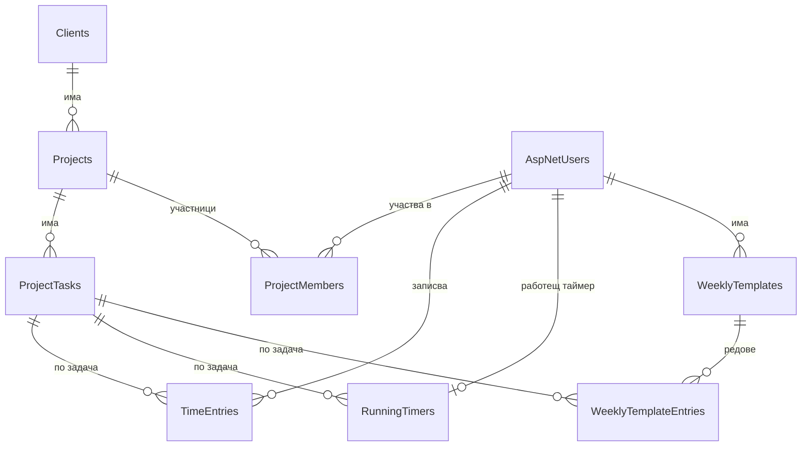

# Task Handler

Уеб система за отчитане и управление на работно време по проекти и задачи.

Дипломен проект – ЧПГДН „СофтУни Будител“, гр. София, професия „Приложен програмист“
(код 481030), специалност „Приложно програмиране“ (код 4810301).

> **Състояние:** в разработка – Етап 1 (концепция, структура на приложението и начална база данни).
> Функционалностите по-долу са **планирани**; в таблицата е отбелязано кои вече са реализирани.

## Предназначение и цел

В малките екипи работното време често се попълва по памет, не се вижда колко струва един проект,
а подготовката на отчет за клиента отнема часове.

**Целта** на проекта е уеб система, в която всеки служител записва времето си по задачи – с таймер
или ръчно – а системата сама изчислява стойността му по почасови ставки и изготвя отчети по период,
клиент, проект и служител.

Системата е предназначена за **екип** с роли (администратор, мениджър, служител). Фактуриране не
е включено – обхватът е ставки и отчети.

## Основни функционалности

| Функционалност | Описание | Състояние |
|---|---|---|
| Потребители и роли | регистрация и вход (ASP.NET Core Identity); роли Администратор, Мениджър, Служител | базата и ролите са създадени |
| Клиенти → Проекти → Задачи | йерархия на работата; архивиране вместо изтриване, когато има история | моделът на данните е готов |
| Участие в проекти | един човек работи по няколко проекта, с отделна ставка за всеки | моделът на данните е готов |
| Таймер | старт/стоп с един клик; само един работещ таймер на човек; не се губи при презареждане | моделът на данните е готов |
| Ръчни записи | дата, начало и край или само продължителност, описание, таксуемо/нетаксуемо | моделът на данните е готов |
| Почасови ставки | приоритет: ставка на човека в проекта → ставка на проекта → ставка на човека по подразбиране; ставката се записва в самия запис | моделът на данните е готов |
| Седмичен шаблон | повтарящите се часове за седмицата се попълват автоматично | моделът на данните е готов |
| Отчети | филтри по период, клиент, проект и служител; часове и пари; таксуемо/нетаксуемо; експорт в CSV | планирано |

**Допълнителни (при наличие на време):** бюджет на проект с предупреждение при превишаване;
заключване на минал период; закръгляне на времето; табло с графики; седмичен изглед (timesheet);
експорт в PDF.

## Използвани технологии

| Част | Технология |
|---|---|
| Приложение | ASP.NET Core MVC, .NET 10, C# |
| База данни | Microsoft SQL Server (LocalDB за разработка) |
| Достъп до данните | Entity Framework Core 10 (Code First, миграции) |
| Потребители и роли | ASP.NET Core Identity |
| Интерфейс | Razor изгледи, Bootstrap 5, JavaScript |
| Тестове | xUnit |
| Среда за разработка | Visual Studio 2026 |
| Контрол на версиите | Git, GitHub |

## Структура на решението

```
TaskHandler/
├── TaskHandler.slnx
├── TaskHandler.Web/        контролери, изгледи, конфигурация, стартиране
├── TaskHandler.Services/   бизнес логика (таймер, ставки, отчети, седмичен шаблон)
├── TaskHandler.Data/       ентитита, конфигурации (Fluent API), DbContext, миграции
└── TaskHandler.Tests/      unit тестове (xUnit)
```

Зависимостите вървят в една посока: `Web → Services → Data`. Тестовете реферират `Services` и
`Data`, но не и `Web`, така че бизнес логиката се тества без уеб сървър и без истинска база.

## Структура на базата данни



| Таблица | Съдържание |
|---|---|
| `AspNetUsers` | потребители (Identity) + име, фамилия, ставка по подразбиране, активен |
| `AspNetRoles` | роли: Administrator, Manager, Employee |
| `Clients` | клиенти |
| `Projects` | проекти на клиент, ставка на проекта, таксуем/нетаксуем |
| `ProjectTasks` | задачи в проект |
| `ProjectMembers` | участие на потребител в проект, ставка на човека в проекта, мениджър на проекта |
| `TimeEntries` | записи на работно време, с копие на ставката към момента на записа |
| `RunningTimers` | работещ таймер – най-много един на потребител (първичният ключ е потребителят) |
| `WeeklyTemplates`, `WeeklyTemplateEntries` | седмични шаблони и техните редове |

Основни правила, които се спазват и от самата база:

- парите са `decimal(18,2)`, ставките не могат да са отрицателни;
- продължителността на запис е от 1 минута до 24 часа; краят е след началото;
- клиент с проекти и проект със задачи не могат да се изтрият (използва се архивиране);
- датите и часовете се пазят в UTC.

## Инструкции за стартиране

### Необходимо

- [.NET 10 SDK](https://dotnet.microsoft.com/download/dotnet/10.0)
- Visual Studio 2026 с работно натоварване **ASP.NET and web development**
  (включва SQL Server Express LocalDB)
- по желание: инструментът за миграции `dotnet-ef`

```bash
dotnet tool install --global dotnet-ef
```

### Стъпки

1. Клонирайте хранилището:

   ```bash
   git clone https://github.com/SimeonPetr0v/Simeon-Petrov-Task-Handler.git
   ```

2. Отворете `TaskHandler/TaskHandler.slnx` във Visual Studio.
3. Създайте базата данни – по един от двата начина:
   - **Package Manager Console:** изберете *Default project* `TaskHandler.Data`, задайте
     `TaskHandler.Web` като startup project и изпълнете `Update-Database`;
   - **команден ред** (в папка `TaskHandler`):

     ```bash
     dotnet ef database update --project TaskHandler.Data --startup-project TaskHandler.Web
     ```

4. Стартирайте `TaskHandler.Web` (F5). Приложението се отваря на `https://localhost:7214`
   (или `http://localhost:5266`).

## Необходими настройки

Връзката с базата е в `TaskHandler/TaskHandler.Web/appsettings.json`:

```json
"ConnectionStrings": {
  "DefaultConnection": "Server=(localdb)\\mssqllocaldb;Database=TaskHandler;Trusted_Connection=True;MultipleActiveResultSets=true"
}
```

Използва се Windows удостоверяване, затова във файла няма парола. Ако се ползва друг SQL Server,
връзката се задава чрез **User Secrets** или променлива на средата
`ConnectionStrings__DefaultConnection`, а не във файла.

В хранилището **не се качват** пароли, ключове и лични данни.

## Тестови потребители и роли

| Роля | Права |
|---|---|
| Administrator | пълен достъп: потребители, ставки, всички клиенти, проекти и отчети |
| Manager | своите проекти, екипа си и отчетите за тях |
| Employee | само собственото си работно време |

Тестовите потребители ще бъдат създавани автоматично при първо стартиране в среда за разработка,
като паролите им се задават чрез User Secrets. Дотогава може да се регистрира нов потребител от
страницата **Register** (без реален имейл сървър връзката за потвърждение се показва на екрана).

## Автор

**Симеон Петров**, XII „В“ клас – [GitHub: SimeonPetr0v](https://github.com/SimeonPetr0v)

## Лиценз

[MIT](LICENSE)
